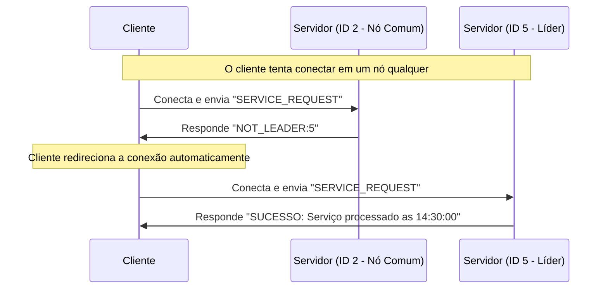

# Trabalho Prático de Sistemas Distribuídos: Algoritmo de Bully e Cliente-Servidor

## 1. Proposta do Trabalho
Este trabalho consiste na implementação de um sistema distribuído baseado na arquitetura **Cliente-Servidor**, utilizando o **Algoritmo de Bully** para **Eleição de Líder**. 

O sistema é composto por múltiplos processos servidores (nós criados via `multiprocessing`) e um cliente externo. O cliente envia requisições de serviço para o sistema. Caso o servidor líder (coordenador) falhe, os nós restantes detectam a falha por meio de *timeouts* de *heartbeats* e iniciam o algoritmo de Bully para eleger um novo líder com base no maior número de identificação (ID/Prioridade) do processo, garantindo a disponibilidade do serviço.

## 2. Requisitos Funcionais

*   **Identificação dos Processos:** Cada servidor rodando na máquina recebe um ID único (ex: 1, 2, 3, 4, 5) que também serve como sua prioridade. Uma porta TCP correspondente é designada a cada nó. O nó com o maior ID sempre será o líder (coordenador).
*   **Servidor (Nós):** 
    *   Comunica-se com outros nós para o algoritmo de eleição através de portas base (trocando mensagens como `ELECTION`, `ALIVE`, `COORDINATOR`, `HEARTBEAT` e `ACK`).
    *   Possui uma *Thread* secundária dedicada exclusivamente a escutar conexões de clientes em uma porta separada (Porta Base + 10000).
    *   Apenas o servidor que atua como líder processa a requisição do cliente. Se um nó não-líder for contatado, ele rejeita o pedido e informa o ID do líder atual.
*   **Cliente:**
    *   O tipo de requisição enviada é uma string de comando (ex: `SERVICE_REQUEST`).
    *   Se o cliente tentar se conectar a um servidor que não é o líder, ele recebe o ID do líder e redireciona a requisição automaticamente.

## 3. Comunicação entre Cliente e Servidor
A comunicação é feita via **Sockets TCP**, garantindo a entrega confiável das mensagens. As mensagens trafegadas são strings codificadas em UTF-8. 

### Diagrama de Sequência (Requisição e Redirecionamento)
Abaixo, o fluxo de comunicação quando o cliente tenta acessar um nó comum, descobre quem é o líder e refaz a requisição.



## 4. Guia de Execução (Ambiente Linux)

O sistema foi desenhado para rodar nativamente em ambientes Linux utilizando o terminal.

**Passo 1: Iniciar os nós do Servidor**
Abra o seu terminal (geralmente `Ctrl + Alt + T` no Ubuntu/Mint) e execute o script principal informando o número de processos e qual nó iniciará como detector:
```bash
python3 bully.py -numproc 5 -detectproc 2
```
*Isso criará 5 processos (IDs de 1 a 5) rodando em background no mesmo terminal.*

**Passo 2: Identificar a porta de um Nó**
O servidor gera portas aleatórias e salva o registro no arquivo `debug.txt`. Abra uma **nova aba no terminal** (`Ctrl + Shift + T`) e use o comando `cat` com `grep` para ver as portas:
```bash
cat debug.txt | grep port
```
Você verá uma saída similar a: `priority 1 has port 16975`.
*Nota: A porta de comunicação para o CLIENTE será essa porta do log somada a 10000 (ex: se a porta do nó 1 for 16975, a porta cliente será `26975`).*

**Passo 3: Executar o Cliente**
Na mesma nova aba de terminal, execute o cliente:
```bash
python3 client.py
```
O prompt pedirá a porta. Digite a porta cliente (ex: `26975`) de um nó que **não seja** o ID 5. Você verá o terminal mostrar o cliente conectando no nó, recebendo o aviso de que não é o líder, e redirecionando perfeitamente para o líder (ID 5).

## 5. Trechos de Código Relevantes

Abaixo estão blocos do código desenvolvido que demonstram os principais conceitos aplicados na implementação:

**Criação dos Processos e Definição de IDs/Prioridade (multiprocessing):**
```python
# Inicializando os nós com IDs correspondentes à sua prioridade
for process_id in range(num_of_processes, 0, -1):
    if process_id == detector_process:
        process = Process(target=run_proc, args=(process_id, shared_vars, lock, True))
    else:
        process = Process(target=run_proc, args=(process_id, shared_vars, lock, False))
    jobs.append(process)
    process.start()
```

**Escuta do Servidor para o Cliente (Thread separada com Sockets):**
```python
def client_listener(priority, shared_vars, client_port):
    c_skt = socket.socket(socket.AF_INET, socket.SOCK_STREAM)
    c_skt.bind(('', client_port))
    c_skt.listen(5)
    
    while True:
        conn, addr = c_skt.accept()
        req = conn.recv(1024).decode('utf-8')
        
        if req == "SERVICE_REQUEST":
            if shared_vars['coordinator_id'] == priority:
                agora = datetime.datetime.now().strftime("%Y-%m-%d %H:%M:%S")
                resposta = f"SUCESSO: Serviço processado pelo Líder (ID: {priority}) as {agora}"
                conn.sendall(resposta.encode('utf-8'))
            else:
                lider_atual = shared_vars['coordinator_id']
                conn.sendall(f"NOT_LEADER:{lider_atual}".encode('utf-8'))
        conn.close()
```

**Lógica do Cliente (Tratamento e Redirecionamento TCP):**
```python
s = socket.socket(socket.AF_INET, socket.SOCK_STREAM)
s.connect(('127.0.0.1', target_port))
s.sendall("SERVICE_REQUEST".encode('utf-8'))
resp = s.recv(1024).decode('utf-8')

if resp.startswith("SUCESSO"):
    print(f"[+] Resposta do Servidor: {resp}")
elif resp.startswith("NOT_LEADER"):
    leader_id = int(resp.split(":")[1])
    print(f"[-] Nó não é o líder. O líder atual é o ID {leader_id}.")
    print(f"[*] Redirecionando para o líder...")
    # Cálculo para pular para a porta do líder usando a base
    target_port = target_port - (target_port % 10) + leader_id 
```